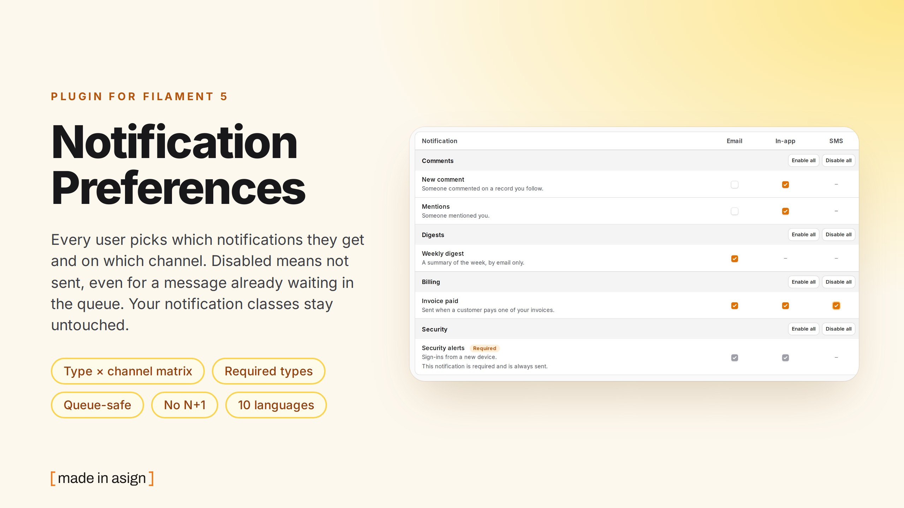
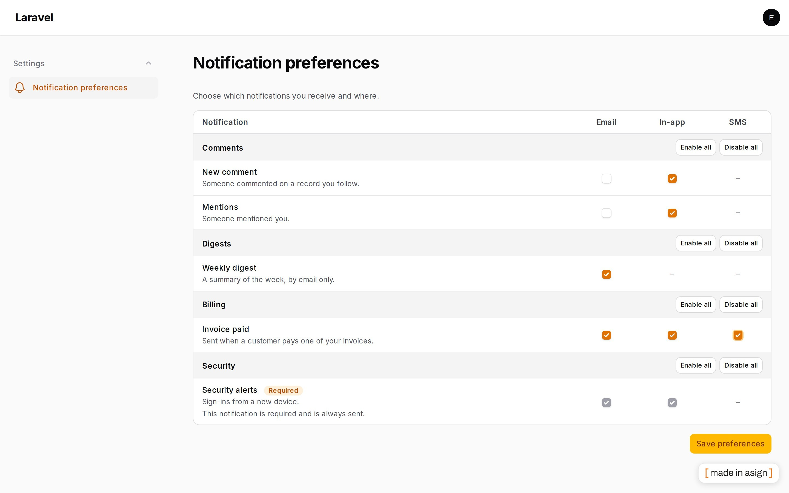
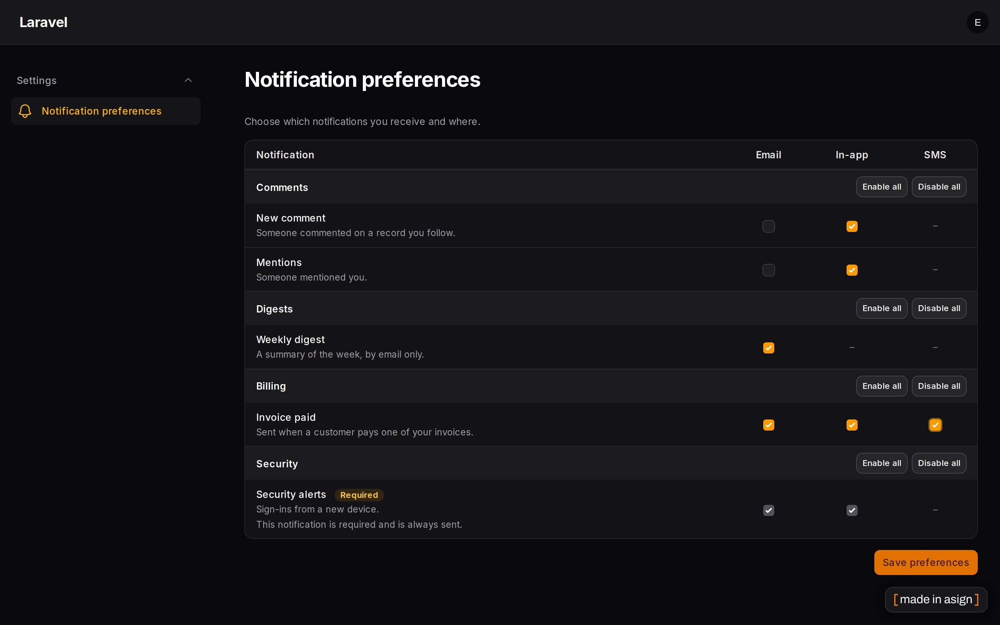

# Filament Notification Preferences

[](https://stand-with-ukraine.pp.ua)
[](https://packagist.org/packages/asignua/filament-notification-preferences)
[](https://github.com/asignua/filament-notification-preferences/actions/workflows/tests.yml)
[](https://github.com/asignua/filament-notification-preferences/blob/main/LICENSE.md)



Panel users get mails and notifications they cannot switch off, and ask the developer. This plugin adds a page where
**every user picks, per notification type and per channel, what they receive** - without changing a single notification class.
You declare the types once (class, label, description, group, channels, default, optionally `locked`); a listener on
Laravel's `NotificationSending` event then cancels what the recipient turned off.

- A **type x channel matrix** on a panel page (and in the user menu), grouped, with "Enable all" / "Disable all" per group.
- **Works for queued notifications**: the choice is read when the notification is *sent*, so turning something off also stops
  a message that was queued yesterday. Covered by a test that starts a real `queue:work` process.
- **Required types** (`locked`): always delivered, shown as such, and untouchable even by a forged request.
- **Your classes and third-party ones are not modified.** A subclass of a declared notification follows its parent's choice.
- **Fails open**: an undeclared notification, an anonymous `Notification::route()` recipient, a channel the type does not offer
  and an error while reading the choices all mean "send".
- Only **deviations from the default are stored**, so changing a default in code reaches everyone who never touched the page.
- One query per recipient on a mass send, an invalidated cache, Octane-safe.
- Integer, UUID and ULID recipients, tested on SQLite, MariaDB 11.4 and PostgreSQL 16. Ten languages.

## Screenshots





On a phone every row becomes a card whose checkboxes are labelled with their channel.

## Requirements

- PHP 8.3+
- Laravel 12 or 13
- Filament 5

## Installation

```bash
composer require asignua/filament-notification-preferences
php artisan vendor:publish --tag=filament-notification-preferences-migrations
php artisan migrate
php artisan filament:assets
```

The migration is a publishable stub, it is not loaded automatically. Optionally publish the config
(`--tag=filament-notification-preferences-config`) and the translations (`--tag=filament-notification-preferences-translations`).

Register the plugin on the panel:

```php
use Asignua\FilamentNotificationPreferences\NotificationPreferencesPlugin;

$panel->plugin(
    NotificationPreferencesPlugin::make()
        ->navigationGroup('Settings')
        ->userMenu(),
);
```

## Declaring the types

Do it in a service provider, so it also runs in a queue worker (which has no panel):

```php
use Asignua\FilamentNotificationPreferences\NotificationPreferences;
use Asignua\FilamentNotificationPreferences\Support\NotificationType;

public function boot(): void
{
    NotificationPreferences::register(
        NotificationType::make(InvoicePaid::class)
            ->key('billing.invoice-paid')          // stable id stored in the database; defaults to the class name
            ->label(fn () => __('Invoice paid'))   // a string or a closure, resolved when the page renders
            ->description('Sent when a customer pays one of your invoices.')
            ->group('Billing')
            ->channels(['mail', 'database', SmsChannel::class => 'SMS'])
            ->default([SmsChannel::class => false]),  // true / false, or per channel (a channel left out stays on)

        NotificationType::make(SecurityAlert::class)->group('Security')->locked(),
    );
}
```

(`NotificationPreferencesPlugin::make()->types([...])` does the same from the panel provider.)

- **Key.** The choices are stored under the key. Without `->key()` it is the class name, which stops matching the day the class is
  renamed: give long-lived types a key (a key or class name must fit 150 characters).
- **Channels** are what the notification's `via()` returns: `mail`, `database`, `broadcast`, or a custom channel class with a label.
  A channel the type does not offer shows as an empty cell and is never blocked.
- **Inheritance.** `class UrgentInvoice extends InvoicePaid` is covered by the `InvoicePaid` entry (the nearest declared parent wins).
- **Locked** types are always sent. The page shows them checked and disabled with a "Required" badge, the server ignores any attempt
  to change them, and the listener never blocks them - even if a stale row says otherwise.

## Asking from code

```php
NotificationPreferences::for($user)->allows(InvoicePaid::class, 'mail');   // also accepts the key or a notification instance
NotificationPreferences::for($user)->matrix();                              // what the user gets now
NotificationPreferences::for($user)->save(['billing.invoice-paid' => ['mail' => false]]);
```

`allows()` fails open (see above). `save()` ignores undeclared keys, locked types, channels the type lacks and non-boolean values.

## Who may open the page

By default any signed-in user - and the page only ever reads and writes **the signed-in user's own** choices; the recipient is never
a request parameter. To narrow it, define the gate `canManageNotificationPreferences` and/or use `->visible(fn ($user) => ...)` on
the plugin (it can only narrow what the gate allows). The check is repeated on every Livewire action, not only on mount.

To put the matrix into your own profile page instead: `->withoutPage()` and render
`@livewire(\Asignua\FilamentNotificationPreferences\Livewire\PreferencesMatrix::class)`.

## Configuration

`config/filament-notification-preferences.php`: `connection`, `table`, `model`, and `cache` (`enabled`, `store`, `ttl`).
Plugin methods: `navigationGroup()`, `navigationLabel()`, `navigationIcon()`, `navigationSort()`, `slug()`, `navigation(false)`,
`userMenu(bool|string)`, `visible()`, `withoutPage()`, `types()`.

## Recipes

**filament-chat.** Its notifications are plain classes:

```php
NotificationPreferences::register(
    NotificationType::make(\Asignua\FilamentChat\Notifications\NewMessageNotification::class)->key('chat.message')->label('New chat message')->group('Chat')->channels(['database']),
    NotificationType::make(\Asignua\FilamentChat\Notifications\MentionNotification::class)->key('chat.mention')->label('Mentions in chat')->group('Chat')->channels(['database']),
    NotificationType::make(\Asignua\FilamentChatPro\Notifications\DigestNotification::class)->key('chat.digest')->label('Chat digest')->group('Chat')->channels(['mail']),
);
```

**filament-kanban-pro and filament-mail-log** send their messages with Filament's `Notification::...->sendToDatabase()`. That method
wraps every message in the same class (`Filament\Notifications\DatabaseNotification`), so there is nothing to tell the kanban notify
step from a bounce alert by type, and **they cannot be governed one by one**. The only handle is the class itself, which switches *all*
`sendToDatabase()` messages of the application on or off together:

```php
NotificationType::make(\Filament\Notifications\DatabaseNotification::class)->key('panel.messages')->label('Panel messages')->group('Panel')->channels(['database']);
```

Use that only when "all in-app panel messages" is a choice you want to give. Otherwise leave them out: unknown means sent.

## Gotchas

- **`Notification::make()->sendToDatabase()` is not governed by type** (explained above).
- **Cache.** A recipient's stored choices are cached in the default cache store for an hour and dropped when the page saves. Editing the
  table by hand takes up to the TTL to show up; call `NotificationPreferences::for($user)->forget()` after a script does it. The `array`,
  `null`, `apc`, `octane` and `session` stores are never used: they are not shared with the queue worker, which would keep an old
  answer. Use redis, memcached, database or file.
- **Two panels, one `->types([...])`.** Declaring the same type (same class, key, channels, defaults and `locked`) twice is fine, the first
  declaration wins (labels are not compared). Two *different* declarations under one key stop the boot with an explicit message.
- **Other `NotificationSending` listeners.** Laravel stops at the first listener that returns a non-null value. A listener registered
  before ours that returns `true`/`false` means ours never runs; register this plugin's provider first, or return `null` from yours.
- **Octane and queue workers.** The per-request memory is a *scoped* container binding, which Octane and the worker reset between
  requests and jobs. The type registry is filled at boot and only read afterwards.
- **Transactions.** On PostgreSQL a failed query aborts the surrounding transaction; the listener fails open for the *notification*,
  but whatever else you do in that transaction is still aborted by the database.
- **Case-insensitive collations** (MariaDB/MySQL default) treat the keys `Billing.Paid` and `billing.paid` as one: keep keys lower-case.
- **Deleted users** leave their rows behind (there is no foreign key, the recipient table is yours); they are tiny and harmless. The same goes
  for rows of a type you stopped declaring: they are ignored (an undeclared type is sent) and never shown. Delete them yourself if you want
  a clean table, e.g. `NotificationPreference::query()->where('type_key', 'old.key')->delete()`; if you re-declare the key later, they apply again.
- **Digests, quiet hours, frequency, one-click unsubscribe and tenant-wide settings are out of scope.**

## Translations

The interface ships in English, Ukrainian, German, Spanish, French, Italian, Dutch, Polish, Brazilian Portuguese and Turkish
under the `filament-notification-preferences::filament-notification-preferences` namespace. **English and Ukrainian are written by
hand; the other eight are machine translations** - corrections are welcome. A test keeps every language in step with the English keys
and placeholders. Override a string by publishing the translations and editing the copy in `lang/vendor/filament-notification-preferences`.

## AI agents

The package ships [Laravel Boost](https://laravel.com/docs/boost) guidelines (`resources/boost/guidelines/core.blade.php`) so a
coding agent wires it up correctly.

## Testing

```bash
composer install
vendor/bin/phpunit
vendor/bin/phpstan analyse --memory-limit=1G
vendor/bin/pint --test
```

`NPREF_DB=mariadb|pgsql` (with `NPREF_DB_HOST`, `NPREF_DB_PORT`; database/user `npref`, password `secret`) runs the same suite against
a real server. One test starts a separate `queue:work` process against the same database.

## Changelog

See [CHANGELOG.md](CHANGELOG.md).

## More plugins by asign

- [Record Lock](https://filamentphp.com/plugins/asign-record-lock) - one editor per record
- [Mail Log](https://filamentphp.com/plugins/asign-mail-log) - every message your app sends
- [Activity Log Plus](https://filamentphp.com/plugins/asign-activity-log-plus) - an audit trail for resources
- [XLSX Export](https://filamentphp.com/plugins/asign-xlsx-export) - typed `.xlsx` downloads of what is on the screen
- [Redirects](https://filamentphp.com/plugins/asign-redirects) - redirects and the 404 log

All plugins: <https://filamentphp.com/plugins?q=asign>

## License

The MIT License (MIT). See [LICENSE.md](LICENSE.md).
